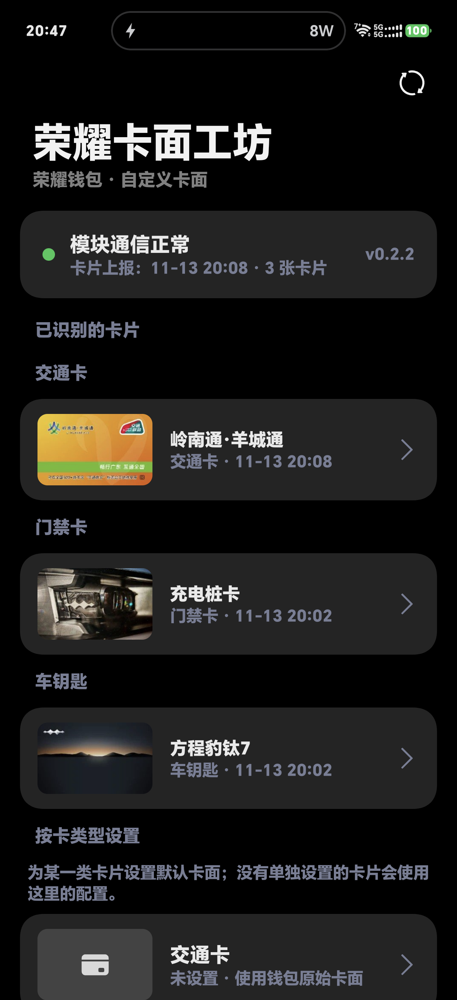
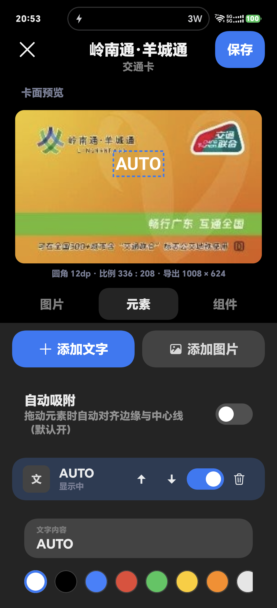
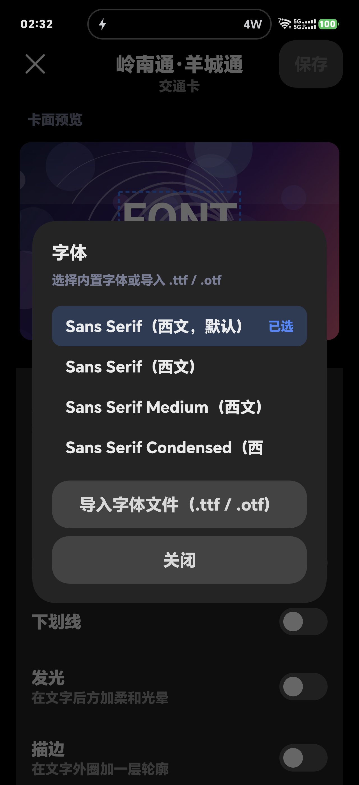
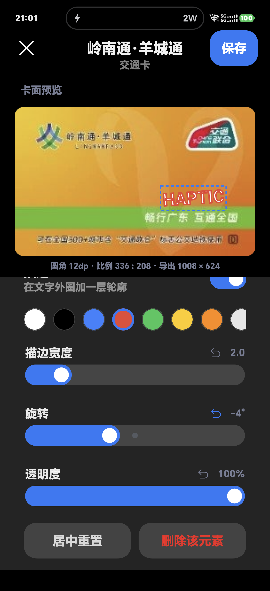
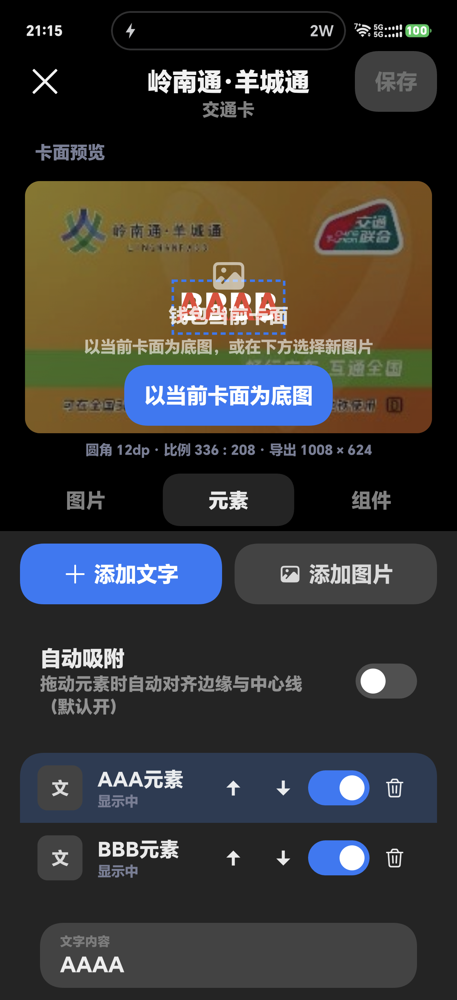
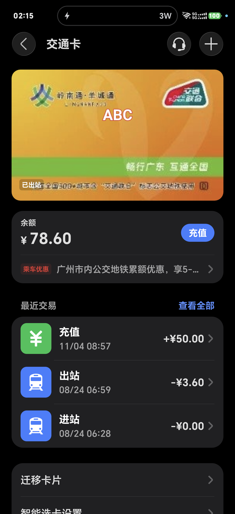

# 荣耀卡面工坊 · Card Personality

[](https://github.com/sofa7320/Honor-Cards-Personality/actions/workflows/build.yml)
[](LICENSE)

> 一个基于 **LSPosed** 的荣耀钱包卡面自定义模块：用你自己的图片替换钱包卡片卡面，并在 Miuix 风格的编辑面板里自由排版（文字、图片贴纸、字体、描边、层级、ZIP 导入导出、隐藏钱包原生组件）。
> 模块由DeepSeek开发，可能存在各种问题，请见谅。

> **English:** An LSPosed module that lets you replace card faces in HONOR Wallet with your own images, with a Miuix-styled editor (text/image stickers, fonts, outline, layers, ZIP import/export). Display-layer replacement only — the wallet app and its data are not modified.

License: [Apache-2.0](LICENSE) · 第三方声明: [NOTICE.md](NOTICE.md)

软件VersionCode常驻1，以便于进行降级安装。但由于软件处于早期开发阶段，变更较多，故非必要情况下，**不建议**进行降级操作，降级操作可能会导致软件的部分功能出现问题。

> ⚠️ 本模块仅改变**显示层**（替换 ImageView 渲染的内容），不会修改荣耀钱包的卡面资源、卡片数据或任何系统文件。需要 **root + LSPosed（Zygisk）**。使用风险自负，详见[免责声明](#免责声明)。

---

## 功能特性

### 🎴 卡面

- 相册选图 / 内置示例图 / **以钱包当前卡面为底图**作为卡面来源
- 等比缩放、平移、水平/垂直翻转；圆角 12dp、比例 336 : 208（导出 1008 × 624）
- 保存后钱包内**实时生效**（无需重启钱包）
- 覆盖模块已适配的卡类型（交通卡、门禁卡、车钥匙、银行卡、校园卡、eBike 等，具体以钱包版本为准）

### ✏️ 编辑面板（Miuix 风格）

- 编辑页固定顶部预览，滚动编辑不再遮挡卡面
- 三个标签页：**图片 / 元素 / 组件**；切换淡入无闪烁，保留各页滚动位置
- 滑杆：点击轨道定位、关键点磁吸（可调强弱）、关键点/两端震动反馈、单项重置；点击右侧数值可**输入数字精准设置**（弹窗标注允许范围）
- **旋转**：-360° ~ +360°，吸附 0/90/180/270/360（±11°，松手补齐），双指旋转需超过 9° 才解锁（防误触），吸附与解锁均有震动
- **尺寸**：5% ~ 200%，默认 50%；双指缩放与滑杆共用同一限制
- **自由摆放**：贴纸位置无范围限制，长图/放大后任意部分都能摆到任意位置
- 层级：列表靠上 = 最上层；↑/↓ 调整；重叠时点击优先选中顶层
- 新增元素自动放到最上层

### 🔤 文字与图片贴纸

- 文字：字体、字号、粗细（100–900）、斜体、下划线、发光、描边、颜色（预设 + 自定义色板/HEX）、透明度、旋转、翻转
- **描边只出现在字形外轮廓**（先描边后填充），不会出现内部描边线
- 字体：内置西文/中文字族（原族名 + 「（西文）/（中文）」标注）、**导入 .ttf/.otf** 自定义字体
- 图片贴纸：透明度、旋转、翻转、尺寸、重命名（长按名称）、显示/隐藏、删除

### 📦 数据

- **卡面 ZIP 导出**到 `Download/honor_cards_personality/`（配置 + 源图 + 贴纸 + 字体）
- **ZIP 导入**恢复卡面（校验格式，非法包有明确错误提示）
- 配置本地 JSON 存储，原子写入、版本化

### 🧩 组件

- 隐藏/保留钱包原生叠加元素（如交通卡详情左下角「已出站」标签等）；修改即时生效

---

## 截图

| 首页                            | 编辑页 · 自动底图                                  |
| ----------------------------- | ------------------------------------------- |
|  |  |

| 字体选择（原族名 + 语言标注）                          | 文字描边                              |
| ----------------------------------------- | --------------------------------- |
|  |  |

| 层级（列表上层 = 渲染最上）                   | 钱包内效果（描边外轮廓）                             |
| --------------------------------- | ---------------------------------------- |
|  |  |

---

## 兼容性

| 项目   | 测试环境                                                              |
| ---- | ----------------------------------------------------------------- |
| 机型   | 荣耀 Magic 7 Pro（PTP-AN10）                                          |
| 系统   | MagicOS 11.0.0.117 / Android 17                                   |
| 荣耀钱包 | 11.0.3.305（priv-app）                                              |
| 框架   | LSPosed 2.2.1（legacy Xposed API，Zygisk）                           |
| 模块   | `com.cardpersonality.honor`，最低 Android 12（API 31+ 体验最佳，minSdk 28） |

- 其他钱包版本可能因类名/布局 id 变化导致 hook 失效；模块采用 **fail-open** 策略（hook 失败不影响钱包正常运行），无配置时严格 no-op。
- 需要已 root 且启用 Zygisk + LSPosed。**bootloader 锁定**的设备请自行评估（本模块不需要修改系统分区或刷机）。

---

## 安装

1. 安装 `CardPersonality-vX.Y.Z.apk`（debug 签名，覆盖安装需先卸载旧版）。
2. 打开 **LSPosed 管理器** → 模块 → 启用「荣耀卡面工坊」。
3. 作用域勾选 **荣耀钱包**（`com.hihonor.wallet`），保存。
4. **先打开一次「荣耀卡面工坊」面板**（新装后必须启动一次：Android 会把未启动过的应用置于 stopped 状态，钱包进程无法通过 ContentProvider 读取配置）。
5. 重启荣耀钱包（或正常重启手机）。打开钱包观察卡面是否已应用。

> 若钱包出现异常，可在 LSPosed 中停用模块后重启钱包，卡面即恢复原样。

---

## 使用

1. 打开「荣耀卡面工坊」，首页会列出钱包已上报的卡片（交通卡 / 门禁卡 / 车钥匙…）。
2. 点选卡片 → 进入编辑页：
   - **图片**：选择图片 / 示例图片 / 以当前卡面为底图；导入卡面（ZIP）、导出当前卡面（ZIP）。
   - **元素**：添加文字/图片贴纸，调整样式、位置、层级；长按列表名称重命名；↑/↓ 调整层级；右侧开关显示/隐藏。
   - **组件**：选择要隐藏或保留的钱包原生标签；可按卡类型设置默认。
3. 点右上角 **保存**，回到钱包打开该卡即可看到新卡面。
4. 导出 ZIP 位于 `Download/honor_cards_personality/`，可备份或分享；同格式 ZIP 可直接导入恢复。

---

## 构建

环境要求：

- JDK **17**
- Android SDK：**Platform 37**（compileSdk 37）、Build-Tools 36+
- Gradle **8.13**（AGP 8.11.2、Kotlin 2.3.x）

```bash
export JAVA_HOME=/path/to/jdk-17
export ANDROID_HOME=/path/to/android-sdk
gradle :app:assembleDebug          # 或 ./gradlew :app:assembleDebug（若已生成 wrapper）
```

Windows（PowerShell，带构建锁的封装脚本）：

```powershell
$env:JAVA_HOME      = "C:\path\to\jdk-17"
$env:ANDROID_HOME   = "C:\path\to\android-sdk"
pwsh -File scripts/build.ps1        # 默认 :app:assembleDebug
```

产物：`app/build/outputs/apk/debug/app-debug.apk`。

> 仓库未附带 Gradle Wrapper（离线环境未生成），如需可执行 `gradle wrapper --gradle-version 8.13` 生成。
> `xposed-stub/` 仅提供 legacy Xposed API 的编译期桩（`compileOnly`），不会打包进 APK。

---

## 项目结构

```
.
├─ app/                      # 模块 App + 编辑面板（Compose/Miuix）
│  └─ src/main/
│     ├─ assets/xposed_init  # LSPosed 入口声明
│     ├─ java/com/cardpersonality/honor/
│     │  ├─ hook/            # Xposed 显示层 hook、Provider 客户端
│     │  ├─ ui/              # Miuix 编辑界面（预览/滑杆/贴纸/字体…）
│     │  ├─ data/            # 配置模型、仓库、ZIP 导入导出
│     │  ├─ FaceRenderer.kt  # 卡面合成（预览/导出共用渲染管线）
│     │  └─ FaceProvider.kt  # 跨进程只读 ContentProvider
│     ├─ res/                # 图标/主题/字符串（DayNight 窗口背景防闪烁）
│     └─ AndroidManifest.xml
├─ xposed-stub/              # compileOnly：legacy Xposed API 桩
├─ scripts/build.ps1         # 带互斥锁的 Windows 构建入口
├─ .github/workflows/build.yml  # CI：构建 + 打 tag 自动发 Release
├─ docs/
│  ├─ ARCHITECTURE.md        # 架构、hook 清单、Provider 契约、线程/版本策略
│  ├─ acceptance/            # 各轮真机验收记录
│  └─ img/                   # 截图
├─ CHANGELOG.md              # 更新日志
├─ CONTRIBUTING.md           # 贡献指南
├─ NOTICE.md                 # 第三方组件与许可声明
├─ build.gradle.kts / settings.gradle.kts / gradle.properties
└─ README.md
```

---

## 技术原理（简述）

- 钱包进程内通过 Xposed hook 拦截卡面显示相关的 getter / ImageView 绑定（如 `ImageView#setImageBitmap`、`Glide` 包装、详情页 adapter），把展示内容替换为面板进程通过 **只读 ContentProvider**（`content://com.cardpersonality.honor.face/...`）提供的配置与合成图像。
- 面板进程负责解码源图、排版贴纸、渲染最终 1008 × 624 卡面（`FaceRenderer`），并把结果以 JPEG/内容 URI 提供给钱包进程；配置以 JSON 原子写入应用私有目录。
- 所有 hook 均使用 **after-hook + 重入保护**，失败不抛出、不影响钱包主流程；无配置时完全 no-op。
- 跨进程调用全部异步（工作线程 + 缓存 + 失败退避），避免钱包主线程阻塞/ANR。
- 更多细节（hook 清单、Provider 契约、线程约束、版本策略）见 [docs/ARCHITECTURE.md](docs/ARCHITECTURE.md)。

---

## 开发与贡献

- 贡献流程、代码约定、测试要求见 [CONTRIBUTING.md](CONTRIBUTING.md)。
- 版本变更见 [CHANGELOG.md](CHANGELOG.md)；架构与 hook 细节见 [docs/ARCHITECTURE.md](docs/ARCHITECTURE.md)。
- CI：[`.github/workflows/build.yml`](.github/workflows/build.yml) 在 push/PR 时自动构建 debug APK 并上传 artifact；
  推送 `v*` 标签时使用 **release 签名**构建并发布 GitHub Release，**Release 正文自动取自 CHANGELOG 对应版本**
  （本次更新内容 + 安装说明），附件为 APK + sha256 + NOTICE.md。
- 签名密钥与 GitHub Secrets 配置见 [docs/RELEASE.md](docs/RELEASE.md)。
- 本地构建：`gradle :app:assembleDebug`（或 `pwsh -File scripts/build.ps1`）。

## 隐私与安全

- 所有编辑数据仅保存在本机应用私有目录；**不上传任何图片或配置**。
- 「以当前卡面为底图」所需原卡面由钱包 CDN 地址下载后仅缓存于本地（用于预览），不修改钱包文件。
- 模块不申请网络上传能力以外的权限（网络用于下载原卡面）；震动使用系统 Vibrator API。
- 不篡改钱包签名/数据/数据库；停用模块后卡面立即恢复原样。

---

## 已知限制

- **仅显示层替换**：钱包内截图分享、导出、系统级卡片展示仍可能是原始卡面。
- 钱包版本更新后类名/布局 id 可能变化导致部分卡类型 hook 失效（fail-open，需适配新版本）。
- 字体描边为单层轮廓；粗体/斜体在字体缺少对应字形时由系统合成。
- 震动效果因机型/系统策略而异（本模块已绕过部分系统对 HapticFeedback 常量的拦截，改用直接 Vibrator）。
- 必须 root + LSPosed；不支持纯 Shizuku/无 root 环境。
- `versionCode` 固定为 1（升级请在 LSPosed 中覆盖安装并保持模块版本），以避免异常降级/更新问题。

---

## 版本历史

| 版本        | 主要变更                                                                                                 |
| --------- | ---------------------------------------------------------------------------------------------------- |
| **0.2.10** | 移植朋友模块 oplus-card-customizer 的 OPPO 卡面读取/替换能力（CircleNetworkImageView 14 入口 + Fin* 容器、11 模型 getter 只读观测与 name/type/balance 上报、file:// 钱包私有目录替换、oppo 映射缓存、诊断计数）；关于页开源支持新增 oplus-card-customizer；Pre-release |
| **0.2.9** | OPPO 读取链路修复（抓原图 FaceCapture、L0 配对并上报卡片、进程内读本地卡面文件、按 getCardType 修正类型映射、圆角安全的本地文件替换、CNIV 参数修正、engine_state pair/capture/faceSource）；关于页新增「开源支持」（Miuix/LSPosed）、「链接」改「反馈」、图标放大；PR 提交，不发 Release |
| **0.2.8** | OPPO/欧加钱包 5.52.0 适配推进（A0/y0/x0/setSvgUrl/F0 入口、卡片上报兜底 identity、引擎诊断）；关于页返回/图标/文案修正，支持钱包仅两项；首页状态行仅包名；PR 提交，不发 Release |
| **0.2.7** | 修复 OPPO/欧加设备检测不到钱包（`<queries>` 6 个候选钱包包 + scan_wallets）；关于页新增「导出诊断报告」（设备/root/属性/开关/LSPosed/操作记录 → Download/honor_cards_personality/logs）；新增 OpLog 操作日志；Pre-release |
| **0.2.6** | 多钱包支持（荣耀钱包 + OPPO/欧加钱包 com.finshell.wallet 5.52.0）；钱包检测与配置按钱包隔离；OPPO 静态逆向卡面 hook（无实机验证）；按钱包区分卡面几何（荣耀 336:208 / OPPO 328:202）；首页「识别钱包包名」、关于页、刷新按钮生效、缩略图自动更新、组件按钱包显示 |
| **0.2.5** | 旋转范围 ±270°；滑杆磁吸减弱；点击数值可精确输入（带范围校验）；双击电源键冷启动显示原卡面修复（钱包内配置/卡面缓存 + 延迟重试）；自适应渲染清晰度（照片 2016×1248，钱包原生卡面按原生分辨率渲染）；以当前卡面为底图无损抓取 |
| **0.2.4** | 长图/大图**自由摆放**（彻底移除位置硬限制）；字体选择增加「（西文）/（中文）」语言标注                                                       |
| 0.2.3     | 旋转 -360~360 + 90° 吸附/防误触/震动；「尺寸」5–200%（默认 50%）；滑杆磁吸与端点震动；仅重命名可保存；新元素置顶；字体原名；描边只留外轮廓；选中性能优化；修复组件隐藏不生效 |
| 0.2.2     | ZIP 导入、自动以当前卡面为底图、滑杆点击定位、更轻吸附、层级方向与命中修正、紧凑字体弹窗、描边填充+彩色、真实震动、防闪烁、选中隔离                                 |
| 0.2.1     | 字体导入上限、错误提示、HEX 归一化等修复                                                                               |
| 0.2.0     | 文字样式（粗细/斜体/下划线/发光/描边/字体）、吸附、翻转、页面动画                                                                  |
| 0.1.0     | 初版：卡面替换、贴纸、编辑面板                                                                                      |

各版本真机验收记录见 [docs/acceptance/](docs/acceptance/)。

---

## 免责声明

- 本项目仅供**个人学习、研究与个性化使用**，与荣耀（HONOR）及其关联公司**无任何关系**，也未获得其授权或认可。
- 「荣耀钱包」及相关商标、资源归其权利人所有；本模块不包含、不分发钱包的任何二进制或卡面资源。
- 修改系统/注入第三方应用存在风险（含数据丢失、应用异常、系统不稳定等），请自行承担；**刷机、root、模块注入可能导致设备保修失效**。
- 请勿将本模块用于商业分发、绕过付费/权限或其他违反法律法规与用户协议的用途。

## 致谢

- [Miuix](https://github.com/compose-miuix-ui/miuix)（top.yukonga.miuix.kmp）— 界面组件与设计规范
- [LSPosed](https://github.com/LSPosed/LSPosed) — 模块加载框架
- AndroidX Compose、Kotlin、jadx（逆向分析辅助）

# 


## 发布流程（维护者）

本项目约定：**每次修改 ersionName 的版本更新，都必须同步发布到 GitHub Release。**

1. 修改 pp/build.gradle.kts 的 ersionName（ersionCode 固定为 1，不要改）。
2. 同步更新 [CHANGELOG.md](CHANGELOG.md)（[Unreleased] → 新版本号 + 日期），提交并推送 main。
3. 打标签并推送，触发 release workflow：
   `ash
   git tag vX.Y.Z
   git push origin vX.Y.Z
   `
4. .github/workflows/build.yml 的 
elease job 会自动构建、生成 CardPersonality-vX.Y.Z.apk 与 .sha256，
   并附带 NOTICE.md 发布 GitHub Release（Release 说明自动生成）。
5. 发布后检查 Release 中的 APK 可下载、版本号正确（面板首页 X.Y.Z）。

> 没有版本号变更的修复/文档/CI 提交只需推送 main（自动构建 artifact，不发 Release）。
